I'm a Ph.D. candidate at [Seoul National University (SNU)](https://www.snu.ac.kr/), working in the [RPM Robotics Lab](https://rpm.snu.ac.kr/) and advised by [Prof. Ayoung Kim](https://ayoungk.github.io/).

[Homepage](https://sangwoojung98.github.io/) · [Publications](https://sangwoojung98.github.io/publications/) · [Google Scholar](https://scholar.google.com/citations?user=I2pNZDkAAAAJ) · [Email](mailto:dan0130@snu.ac.kr)

## Research Interests

My research interests include **Spatial AI, robot vision, legged robots, and radar**. I work on robot odometry and mapping, including radar–leg–inertial sensor fusion and online 3D Gaussian Splatting under motion blur.

## Skills

  
  
  
  
  
  
  
  
  

## GitHub Stats

|  |  |
| --- | --- |
